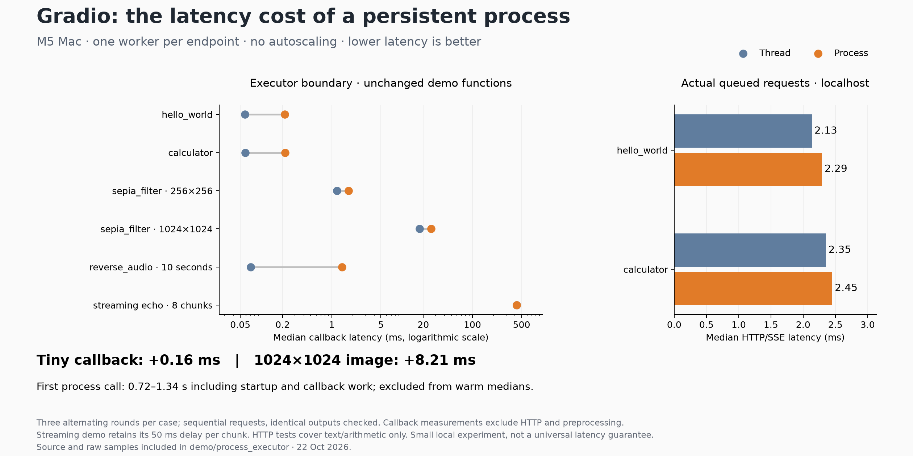

# Process-only executor latency — 2026-10-22

Measured locally on an Apple M5 with 32 GiB unified memory, using the five repository demo callbacks listed below. One persistent process per endpoint, with no autoscaling, batching, memory sampling, or simultaneous benchmark/test runs. Original demo callback bodies and imports are used unchanged; their UI construction is omitted.

## Warm callback latency

This isolates execution/IPC from HTTP, component preprocessing, upload/download and queue waiting. The baseline dispatches through AnyIO's thread pool, as ordinary synchronous Gradio callbacks do. Values are milliseconds; each cell is **median / p95** across three alternating rounds.

| Demo / payload             |       Thread (ms) |      Process (ms) | Median difference (ms) | Calls per mode |
| -------------------------- | ----------------: | ----------------: | ---------------------: | -------------: |
| hello_world                |     0.059 / 0.066 |     0.216 / 0.250 |                 +0.157 |           1500 |
| calculator                 |     0.059 / 0.069 |     0.217 / 0.278 |                 +0.157 |           1500 |
| sepia_filter · 256×256     |     1.186 / 1.269 |     1.735 / 1.811 |                 +0.549 |            300 |
| sepia_filter · 1024×1024   |   17.698 / 18.568 |   25.911 / 45.747 |                 +8.213 |            180 |
| reverse_audio · 10 seconds |     0.070 / 0.194 |     1.394 / 1.542 |                 +1.324 |            300 |
| streaming_echo · 8 chunks  | 427.653 / 434.456 | 426.288 / 431.955 |                 -1.365 |             45 |

The tiny functions show a small absolute IPC overhead. Large array copies are material: the 1024×1024 sepia output is a 24 MiB float64 array (input is 3 MiB). Audio reversal normally returns a cheap NumPy view; process execution must copy/serialize approximately 1.83 MiB in each direction. The image process path also has a long tail (recorded maximum about 359 ms), so the median alone does not capture all observed latency.

Streaming retains the original demo's 50 ms sleep per chunk. Its small negative median difference is scheduling variation, not evidence that processes accelerate streaming. Outputs were checked for equality in every measured call.

## Actual HTTP/SSE queue latency

Both execution modes run on the same localhost Server, using a persistent HTTP session. Three alternating rounds of 50 sequential requests per mode, after five warmups. This tests actual queued requests for text/arithmetic; it is not an end-to-end image/audio benchmark.

| Demo       | Thread median / p95 (ms) | Process median / p95 (ms) | Median difference (ms) |
| ---------- | -----------------------: | ------------------------: | ---------------------: |
| greet      |            2.134 / 2.463 |             2.292 / 2.491 |                 +0.158 |
| calculator |            2.351 / 2.720 |             2.451 / 2.703 |                 +0.100 |

## Cold calls and streaming

First process calls are excluded from warm measurements. These include interpreter/import/resource initialization **and the actual callback**; the streaming case includes its eight delayed chunks.

- hello_world: 0.738 seconds.
- calculator: 0.721 seconds.
- sepia_filter · 256×256: 0.832 seconds.
- reverse_audio · 10 seconds: 0.782 seconds.
- streaming_echo · 8 chunks: 1.343 seconds.

Streaming first-chunk median / p95: thread 53.805 / 55.633 ms; process 53.151 / 55.544 ms;

Every observed worker initialized its registered resource once and reused the same PID across calls. The larger image case reused the already-warm image endpoint. Model loading would add to these cold-start times.

## Reproduction and limits

See [README.md](README.md) for commands and scope. Raw samples, first-chunk times, source SHA-256 hashes and environment details are in [callbacks.json.gz](results/callbacks.json.gz) and [http.json.gz](results/http.json.gz). The plot is generated by `plot_results.py`.

These are repeated calls on one Mac, not independent hardware trials or universal latency guarantees. Windows, Linux/CUDA, concurrent workloads, long-lived async clients and large HTTP uploads are not benchmarked here. Existing Blocks execution remains unchanged; these callbacks are adapted to the new Server executor.

Focused validation: **16 passed, 1 skipped** in `test/test_processing.py` and `test/test_server.py`, including a real HTTP request and worker cleanup on shutdown. Full backend test collection stops on the missing `docker` dependency. Repository-wide formatter/type-check scripts were run; `ty` reported 625 diagnostics and Svelte checks 16 errors / 400 warnings. Unrelated formatter changes were excluded. Targeted changed-file Ruff checks and `git diff --check` pass.
