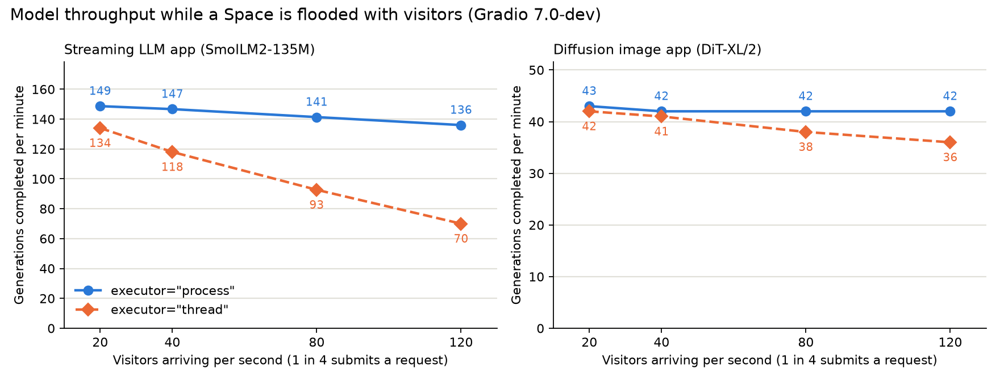
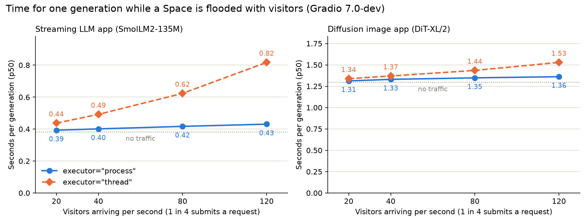

# Benchmark: `executor="thread"` vs `executor="process"`

What does running the server in a separate gateway process (the 7.0 default) buy a
realistic ML app? Measured on 7.0-dev `08a0e720e`, Python 3.12, one Apple M5 laptop
(10 cores, 32 GB), everything on localhost.



**Takeaway:** the landing page stays fast in both modes. What the gateway process
protects is the model: in thread mode, serving visitors competes with the function
for the GIL, so throughput falls as traffic rises. In process mode it stays flat.

## Apps

- `app.py`: image generation, modelled on the text-to-image Spaces that dominate
  trending. DiT-XL/2 (class-conditional diffusion) on MPS, 20 steps, output
  upscaled to 1024 px. `BENCH_PIXEL=1` adds a palette-quantisation pass written in
  plain Python (holds the GIL for about 70 ms).
- `chat.py`: a streaming chat on SmolLM2-135M-Instruct (MPS), 96 tokens streamed
  one by one. The generate loop of a model this small is mostly Python.

Both are plain `gr.Interface` apps with the default `concurrency_limit=1`; the
executor is chosen with `GRADIO_EXECUTOR`.

## Viral traffic sweep (`viral.py`, `sweep.sh`)

Visitors arrive at a fixed rate for 30 s. Each loads the page the way a browser
does (`/`, `/config`, `/theme.css`, the main JS bundle); one in four then submits a
request with `POST /gradio_api/queue/join` and waits on its
`/gradio_api/queue/data` stream. Three repeats per point for the LLM app, two for
the diffusion app, executor order alternated. No request failed in any of the 40
runs.

Generations completed per minute (mean of the repeats):

| Visitors/s | LLM, thread | LLM, process | | Diffusion, thread | Diffusion, process | |
|---|---|---|---|---|---|---|
| 20 | 134 | 149 | +11% | 42 | 43 | +2% |
| 40 | 118 | 147 | +25% | 41 | 42 | +2% |
| 80 | 93 | 141 | +52% | 38 | 42 | +11% |
| 120 | 70 | 136 | +94% | 36 | 42 | +17% |

Seconds per generation, p50 (0.38 s for the LLM app and 1.29 s for the diffusion
app with no traffic):

| Visitors/s | LLM, thread | LLM, process | Diffusion, thread | Diffusion, process |
|---|---|---|---|---|
| 20 | 0.44 | 0.39 | 1.34 | 1.31 |
| 40 | 0.49 | 0.40 | 1.37 | 1.33 |
| 80 | 0.62 | 0.42 | 1.44 | 1.35 |
| 120 | 0.82 | 0.43 | 1.53 | 1.36 |



Page load for a new visitor (all four requests), mean of the repeats' p50 / p99:

| Visitors/s | LLM, thread | LLM, process | Diffusion, thread | Diffusion, process |
|---|---|---|---|---|
| 20 | 8 / 11 ms | 7 / 14 ms | 7 / 11 ms | 7 / 8 ms |
| 40 | 8 / 14 ms | 7 / 12 ms | 7 / 12 ms | 7 / 10 ms |
| 80 | 8 / 27 ms | 7 / 23 ms | 7 / 36 ms | 7 / 21 ms |
| 120 | 9 / 84 ms | 9 / 72 ms | 8 / 85 ms | 9 / 57 ms |

## Without traffic (`bench.py`)

One user, then 8 users with 3 requests each, on the diffusion app (two runs per
executor, order alternated):

| | thread | process |
|---|---|---|
| Startup to the first 200 on `/` (median of 6) | 4.6 s | 5.8 s |
| RSS, app process | ~975 MB | ~975 MB |
| RSS, gateway process | – | 132 MB |
| One user, end-to-end p50 | 1.38–1.39 s | 1.38–1.39 s |
| Gradio overhead per request (end-to-end minus the function) | 72–75 ms | 73–74 ms |
| 8 users x 3 requests, throughput | 0.69–0.72 req/s | 0.73–0.74 req/s |

The extra process hop adds no measurable latency. The cost of the process executor
is about 1.2 s of startup and about 130 MB. On CPU-only inference (`results/baseline/cpu_*.json`)
the two were indistinguishable. With the plain-Python pixel pass
(`results/baseline/pix_*.json`), the worst page load during the 8-user test was 76 ms
in thread mode in both runs, against 4–10 ms in process mode.

## Caveats

- One machine, localhost, and the load generator shares the machine with the app.
- SmolLM2-135M is unusually Python-bound. A larger model spends more of each step
  in GPU kernels, so its gap should sit between the two apps here. Not measured.
- When every visitor submits at 80/s (`results/viral/v80_*.json`), both executors
  start returning 503 on `/queue/join` and dropping streams at about 2,000 waiting
  sessions. That matches the 2,000-entry `LRUCache` for
  `pending_messages_per_session` in `gradio/queueing.py`, but the cause is not
  confirmed. The sweep stays under that number.

## Reproduce

```bash
pip install torch diffusers transformers accelerate psutil matplotlib
export HF_HUB_OFFLINE=0   # first run downloads facebook/DiT-XL-2-256 and SmolLM2-135M-Instruct
python bench.py mps 20 results/baseline/mps_a.json   # device, steps, output
python viral.py chat.py process 80 30 out.json       # app, executor, visitors/s, seconds
SUBMIT_EVERY=4 ./sweep.sh && python aggregate_sweep.py && python plot.py
```

`summarize.py` and `summarize_viral.py` print one-line summaries of the result files.
